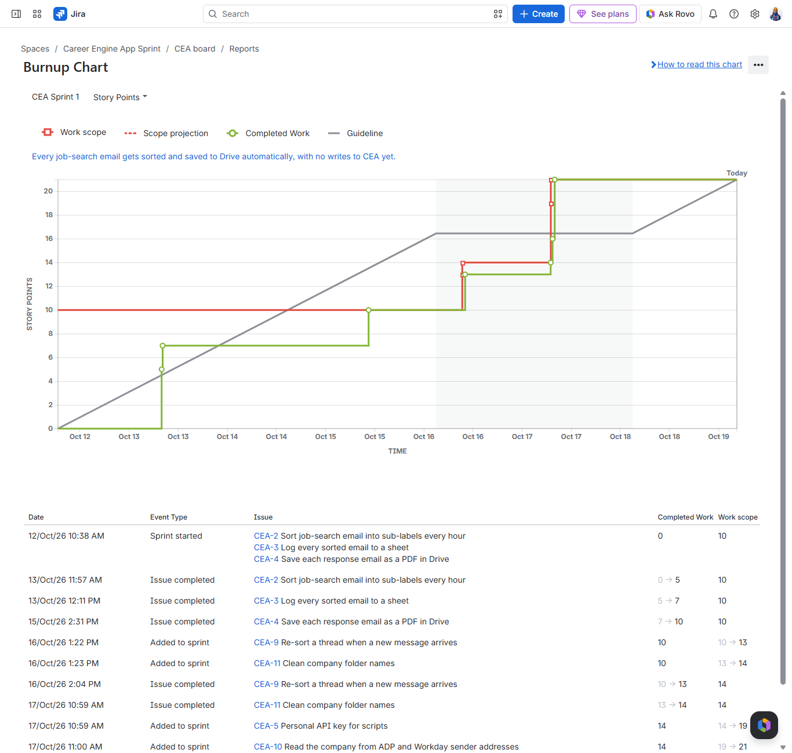
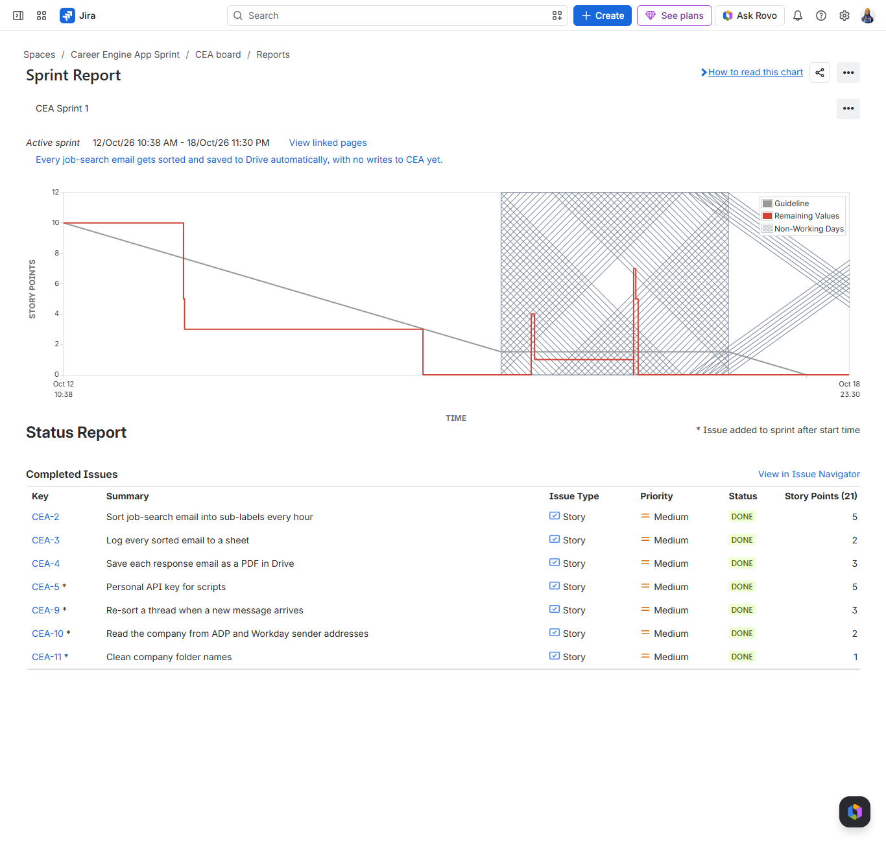

# CEA Scrum Sprint

**Jira | Scrum | Google Apps Script**

One real Scrum sprint run on Career Engine App's live backlog in Jira, building a Gmail automation that sorts, logs and saves job-search email. This is a solo adaptation: I held Product Owner and Scrum Master, and the dev work was paired with Claude the same way all Career Engine App work is.

---

# Project Overview

Every employer response to my job applications used to be printed to PDF, uploaded to Drive and linked into Career Engine App by hand. Responses arriving at a second inbox were easy to miss entirely. Sprint 1 automated the first half of that: sorting job-search email into sub-labels every hour, logging each sorted email to a sheet, and saving responses as PDFs to Drive, with no writes to Career Engine App yet.

The sprint ran Monday 10/12 through Sunday 10/18/2026 in a Jira Free Scrum project, with the review and retro on Monday 10/19. Daily standups went up as Jira comments and are kept in `standups.md`. **Result: goal met, 7 of 7 stories Done, 21 of 21 points.**

  

---

# Sprint Results

## 1️⃣ Burnup Chart

Sprint 1 started with 10 points and the goal was met on Thursday. Four more stories were pulled in after that, so scope climbs from 10 to 21 while completed work keeps pace. The table under the chart logs each scope change and completion.

## 2️⃣ Sprint Report

The burndown against the guideline, with the 7 completed issues and their points. Asterisks mark the stories added after the sprint started.

---

# What Was Built

| Story | What it does | Points | Done check |
|---|---|---|---|
| CEA-2 | Sorts Job Search email into sub-labels every hour | 5 | 215-thread backlog sorted; 10 of 10 hand-checked threads right |
| CEA-3 | Logs every sorted email to a sheet | 2 | One row per thread, deduped by thread ID; 5 of 5 spot-checked against Gmail |
| CEA-4 | Saves each response email as a PDF in Drive | 3 | 16 PDFs saved into company folders, 0 left |
| CEA-9 | Re-sorts a thread when a new message arrives | 3 | An interview invite moved from Review to Interview |
| CEA-10 | Reads the company from ADP, Workday and iCIMS sender addresses | 2 | Node test of 21 real addresses; 7 of 19 saved PDFs refiled |
| CEA-11 | Cleans company folder names | 1 | A messy multi-brand folder name fixed on refile |
| CEA-5 | Personal API key for scripts (in the Career Engine App repo) | 5 | 16 tests, CI green, live-checked, adversarial review approved |

---

# How It Was Built

- **Hourly trigger** runs `sortJobSearch`. `Sorter.gs` reads the Rules sheet (Order, Category, Field, Contains); the first matching rule wins and anything unmatched goes to Review.
- **Log** writes to a header-mapped Log tab and skips any thread ID already logged.
- **Save** turns response threads into PDFs in `Job Search Responses/<Company>`. The company comes from the Senders tab first, then the subject line, the sender address and the display name.
- **Settings** live in Script Properties, never in code.

| File | Role |
|---|---|
| `Config.gs` | Reads Script Properties |
| `Rules.gs` | Loads the Rules sheet, normalizes text, finds the first matching rule |
| `Sorter.gs` | Hourly sort, re-sort on new messages, dry-run previews |
| `Log.gs` | Log tab writes and thread-ID dedupe |
| `Save.gs` | PDF export, company lookup, refile |
| `Setup.gs` | One-time setup for labels, tabs and Senders rows |

**Scrum practice:** a sprint goal set at planning, a daily standup on the epic (CEA-1), every story checked against real incoming mail before Done, backlog grooming mid-sprint, then a review and a retro whose lessons carry into Sprint 2.

---

# Tools Used

- Jira Free (Scrum template): backlog, board, burnup, sprint report
- Google Apps Script, deployed with clasp
- Gmail, Google Sheets, Google Drive

---

# Author

**Sawandi Kirby**

Data Analytics & Business Intelligence
Benchline Analytics - Data intelligence for organizations that mean business.

- GitHub: https://github.com/visualkirby
- LinkedIn: https://linkedin.com/in/sawandi-kirby
- Kaggle: https://kaggle.com/sawandikirby
